# Shellport

Shellport is a browser-based SSH client, like PuTTY hosted on a web server. Sign in with GitHub, confirm with an authenticator code, and open a terminal on the hosts an administrator has set up.

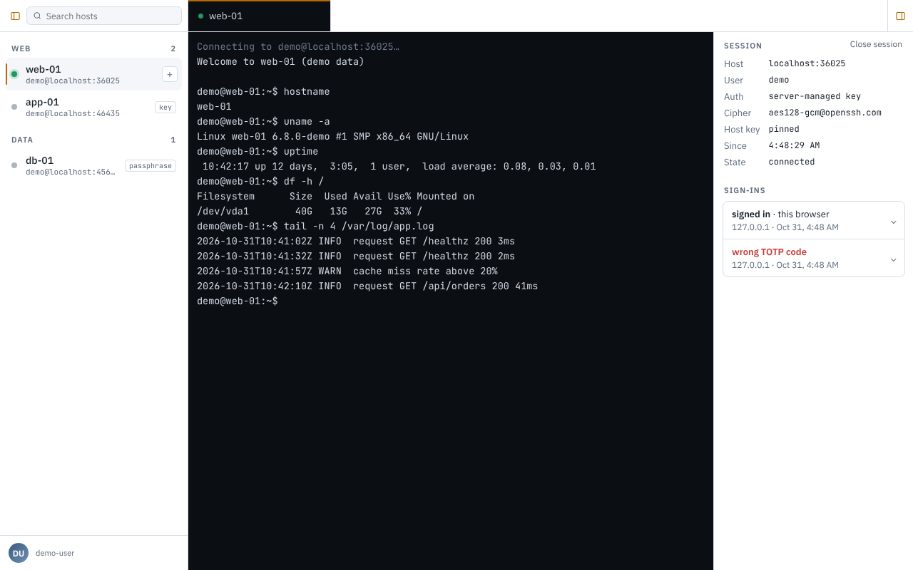

The screenshots show a local instance with demo hosts and a demo account. No real hosts, keys or identities appear in them.

## Features

- **GitHub sign-in plus a one-time code.** Only GitHub accounts listed in `config.json` can get in, and each needs a time-based code from an authenticator app. A code can't be used twice.
- **Preconfigured hosts only.** Administrators define hosts, credentials and pinned host keys on the server. Users pick a host from the list. They can't add connections or see private keys.
- **Passphrases typed in the browser.** If a key is passphrase-protected, the terminal asks for the passphrase when you connect. It is never stored or logged by the server. Optionally, **Account → SSH key passphrases → Remember passphrases** remembers each passphrase in this browser only (see [SECURITY.md](SECURITY.md)).
- **Tabs and sessions.** Open several sessions to the same host, drag tabs to reorder them, and check your recent sign-ins in the session panel.
- **Up to 8 sessions on one screen.** The Layout button in the tab bar opens a view of up to 8 sessions, on the same host or different ones. Drag a session's title bar onto the edge of another to dock it beside it, or onto the middle to swap places. Drag a host from the sidebar to open it next to any session, drag dividers to resize them, and use Single to show one session at a time.
- **File explorer per tab.** The folder icon on an SSH tab switches that tab between the terminal and its files, over SFTP on the same connection. Browse, view small text files, download, and delete. It acts as the host's SSH user, so the host's own permissions apply. Upload is not supported yet.
- **Works on a phone.** The host list and session panel open over the terminal on small screens.

## Screens

Shellport follows your system's light or dark setting. Dark is the default, and light applies when your system prefers light. There is no in-app switch.

### Light theme

<table>
  <tr>
    <td width="50%">
      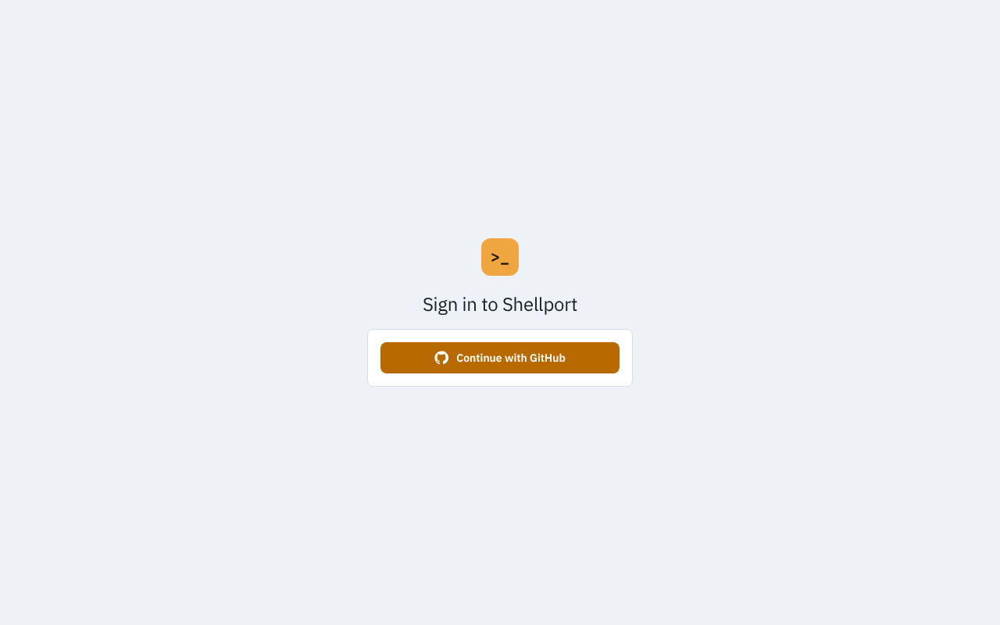<br>
      <sub>Sign in with GitHub</sub>
    </td>
    <td width="50%">
      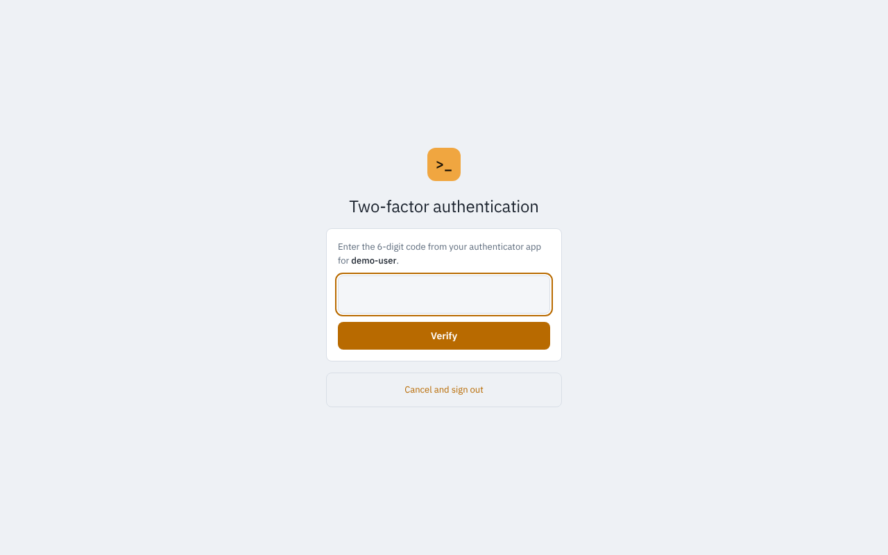<br>
      <sub>Enter the code from your authenticator app</sub>
    </td>
  </tr>
  <tr>
    <td width="50%">
      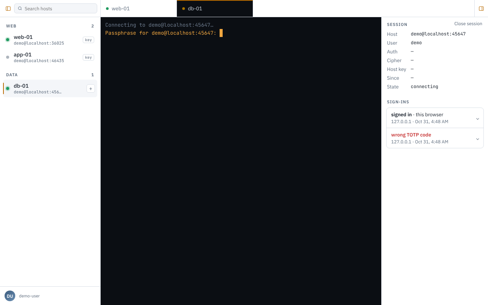<br>
      <sub>Passphrase prompt for a protected key</sub>
    </td>
    <td width="50%">
      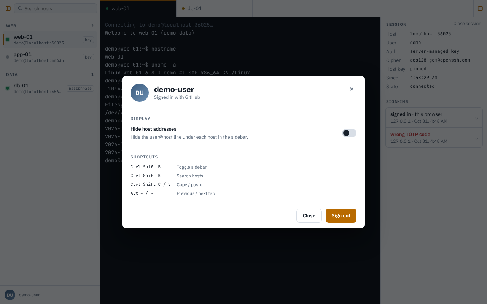<br>
      <sub>Account tab, with shortcuts and sign out</sub>
    </td>
  </tr>
</table>

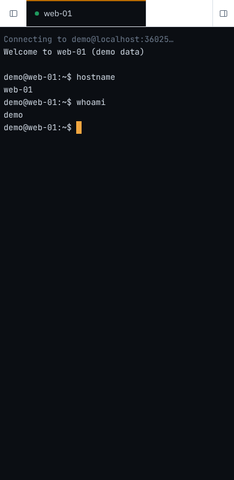<br>
<sub>The terminal on a phone</sub>

### Dark theme

<table>
  <tr>
    <td width="50%">
      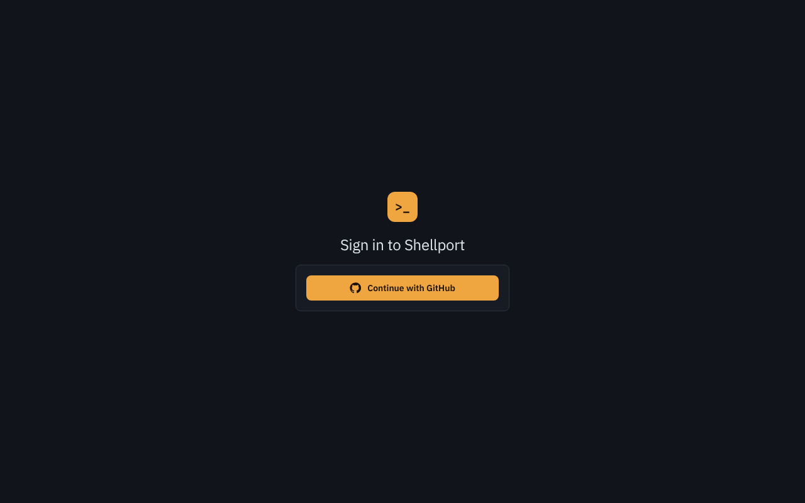<br>
      <sub>Sign in with GitHub</sub>
    </td>
    <td width="50%">
      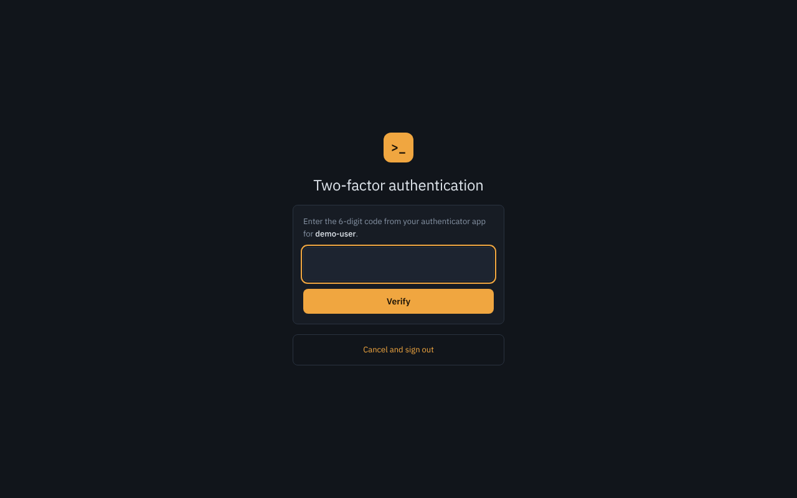<br>
      <sub>Enter the code from your authenticator app</sub>
    </td>
  </tr>
  <tr>
    <td width="50%">
      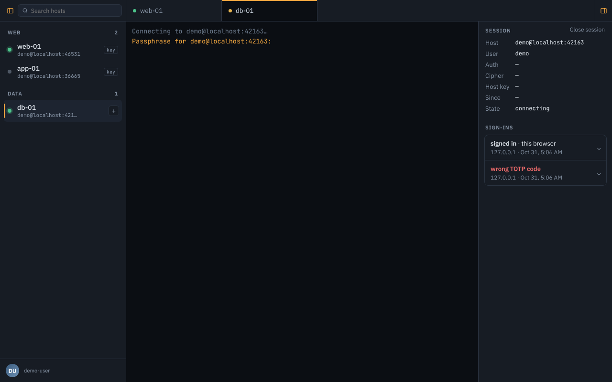<br>
      <sub>Passphrase prompt for a protected key</sub>
    </td>
    <td width="50%">
      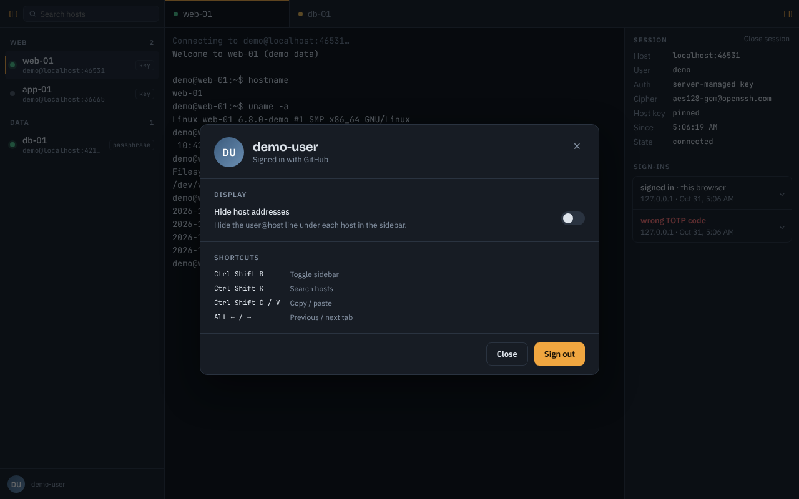<br>
      <sub>Account tab, with shortcuts and sign out</sub>
    </td>
  </tr>
</table>

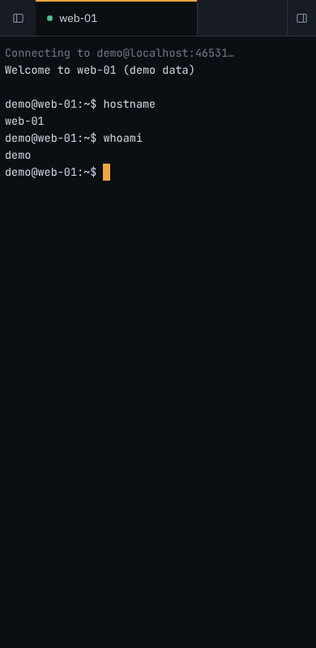<br>
<sub>The terminal on a phone</sub>

## Quick start

1. Create a GitHub OAuth app with the callback URL `http://localhost:8080/auth/github/callback` for local use, or your HTTPS origin followed by `/auth/github/callback`.
2. Create a writable `vault` folder. On Linux it must be writable by container user 1000.
3. Run `docker compose up -d --build` and open `http://localhost:8080`.
4. Find the one-time setup code in `docker compose logs shellport`. Enter it in the wizard, configure OAuth, users and SSH hosts, and choose a vault passphrase. Upload an SSH key or choose **Enter password into vault** for host credentials.
5. Setup writes only the encrypted vault. After each restart, enter the passphrase to unseal it before signing in.

Use HTTPS for remote access. Keep the vault passphrase in a password manager; it cannot be recovered.

## Try it with demo hosts

To test without real servers, start two demo SSH servers in Docker: one with a plain key and one with a passphrase-protected key. You still need the OAuth app and authenticator secret from the quick start.

```sh
npm run demo:setup
docker compose -f docker-compose.yml -f docker-compose.demo.yml up -d --build
```

The setup generates the keys, starts the demo servers and pins their host keys in `config.json`. The passphrase for the protected key is saved to `demo-locked.passphrase`.

## Production with HTTPS

The `deploy/` folder runs Shellport behind Caddy, which handles HTTPS certificates.

1. Set `server.publicUrl` in the setup wizard or vault to your HTTPS address, for example `https://ssh.example.com`.
2. Set the same callback URL on your OAuth app: `https://ssh.example.com/auth/github/callback`.
3. Create a writable `deploy/vault` folder and set your domain in `deploy/Caddyfile`. Configure the server through the setup wizard, using your HTTPS origin.
4. From `deploy/`, run `docker compose up -d`.

## Configuration

Shellport requires `vault.sealed`. A legacy `config.json` can only be imported using `npm run vault -- seal`. Start from [`config.example.json`](config.example.json). A secret can be a plain string, `{ "env": "VAR_NAME" }` or `{ "file": "path/to/file" }`. Environment and file references are resolved once during setup or CLI import and stored inside the vault. The running vault does not depend on external secret references.

| Section | What it controls |
| --- | --- |
| `server` | Port, listen address, `publicUrl` (the origin used for OAuth redirects and WebSocket checks) and `trustProxy`. |
| `github` | OAuth app `clientId` and `clientSecret`. |
| `users` | Who may sign in, by numeric GitHub ID or login, each with a `totpSecret`. Set `"admin": true` on a user to let them add hosts from the browser. A `passkeys` list is written by Shellport when a user adds a passkey under Account; do not edit it by hand. |
| `hosts` | Preconfigured SSH destinations: address, user, credentials, pinned `hostKeyFingerprints`, optional `allowedUsers`, and `files` (set it to `false` to turn off the file explorer for that host; it is on by default). |
| `limits` | Terminals per user, idle timeout, sign-in attempts per 15 minutes, `maxDownloadMB` (largest file the explorer will download, default 256), and `auditRetentionDays` (how long the audit log is kept, default 90). |
| `recording` | Session recordings: `enabled` (default `true`), `retentionDays` (default 90) and `maxMB` (largest recording per session, default 100). See [Session recordings](#session-recordings). |
| `session` | How long a sign-in lasts (`ttlHours`). |
| `security` | Security options. Leave `allowUnpinnedHostKeys` at `false`. |

To pin a host key, run `ssh-keyscan <host> | ssh-keygen -lf -` and copy the `SHA256:` fingerprint into `hostKeyFingerprints`. Shellport refuses to connect if the fingerprint changes.

**Host authentication**

- **SSH key:** the private key stays on the server. If the key is passphrase-protected, the user types the passphrase in the terminal tab when connecting.
- **Password:** stored on the server as an `env` or `file` secret. It is never sent to the browser.

**Adding hosts from the browser.** A user with `"admin": true` sees an **Add host** button under the host list. The dialog takes a name, optional group, host or IP, port and user, and either an existing key or an uploaded private key. Shellport connects once to read the host's SSH key and pins it, so check that the address is the machine you mean. A key without a passphrase is only saved after the admin confirms a warning; passphrase-protected keys ask for the passphrase in the terminal each time. Every signed-in user sees the new host. Admins also see a pencil on each host: **Edit** changes any field (leave the key as it is, pick another, or upload one) and **Delete host** removes it after a confirmation. Deleting closes open terminals to that host, the last host cannot be deleted, and the host key is pinned again only when the address or port changes. A key file is removed only if Shellport created it and no other host uses it. Nobody is an admin unless you set the flag. The setup wizard marks the first user, and converting a plain `config.json` with `npm run vault -- seal` promotes the first user when nobody in the file is an admin yet; change it with `npm run vault -- edit`. A server unsealing a vault in which nobody is an admin treats the first user as one (and logs a notice), so vaults made before this feature need no edit; add an `admin` flag to a user, with `npm run vault -- edit`, to choose someone else.  Hosts and uploaded keys are saved in the encrypted vault:

- **Sealed:** the host and an uploaded key go into the vault, which is re-encrypted in place. This needs the vault folder to be writable and the server to have been unsealed since the vault was last changed by `npm run vault -- edit` or `import`; otherwise adding fails and you should seal and unseal once.

**Setup wizard.** If Shellport starts without a vault or legacy `config.json`, it opens a setup wizard instead of the app and prints a one-time **setup code** in its server log (`docker compose logs shellport`). Enter that code to configure the server, GitHub OAuth, session limits and SSH hosts. The wizard can also generate TOTP secrets with QR codes, check the config against the schema, and preview the configuration. Setup requires HTTPS or an address on localhost. All setup APIs require the code; it stops working after a successful save, and restarting setup generates a new one. Native setup listens on loopback by default; set `HOST` to expose it elsewhere. The Docker image listens on all container interfaces and the local compose file publishes it on loopback. You can force the wizard with `SHELLPORT_SETUP=1`. Behind an HTTPS reverse proxy, set `SHELLPORT_TRUST_PROXY` to the number of proxy hops; the supplied Caddy deployment sets it to `1`.

## AI command suggestions

AI suggestions are disabled by default. An administrator can open **Account → Server → AI suggestions**, acknowledge the data-sharing notice, and configure a LiteLLM gateway URL, model alias, and gateway API key. The key is stored in the encrypted vault. For a LiteLLM service on the same Docker network, the base URL can be `http://litellm:4000/v1`; for a remote gateway use its HTTPS URL ending in `/v1`. Shellport does not deploy LiteLLM. Configure and secure the gateway separately, including its upstream provider, logging and spending controls. Use TLS for remote connections; HTTP sends prompts and the gateway key without transport encryption.

When enabled, signed-in users get a sparkle button in the tab bar (or **Alt Shift A**) that opens the Ask AI panel at the bottom of the active terminal. **Esc** closes it while the panel has focus. The reply shows one command in a code block with **Copy** and **Insert at prompt**, which types the command into the terminal without pressing Enter. Multi-line commands and replies that are not a single command can only be copied.

By default only the text the user types is sent. Two per-request options are off by default: **Include host context** sends the operating system, shell, architecture and username detected when the session opened (shown as a chip, exactly as sent), and **Include last few lines of terminal output** sends the last 15 lines on screen after showing a preview, which may contain secrets. Hostnames, IP addresses, host keys, bastion routes and vault data are never sent. LiteLLM and its upstream provider may log or retain prompts and incur charges. Users must review suggestions: models can produce incorrect or destructive commands. Shellport never executes a suggested command.

## Required encrypted vault

Sealed mode keeps your configuration and SSH keys encrypted on disk. Instead of `config.json` and `.env`, Shellport has one file, `vault.sealed`, and it starts "sealed": the only page it serves is an unseal screen. Someone who knows the passphrase unlocks it in the browser, after which the usual GitHub sign-in and TOTP code apply. Nothing is ever written to disk in plain text.

**Startup.** When `vault.sealed` is missing, Shellport opens the setup wizard. When it exists, Shellport opens the unseal page. Legacy `config.json` files are ignored by startup. You can configure a fresh vault in setup or explicitly convert an old config using `npm run vault -- seal`. Remove old plaintext config, environment and key files after verifying your vault; they are not automatically deleted.

**Create a vault.** On a fresh install the setup wizard encrypts by default: the last step asks for a passphrase and writes `vault.sealed`, and no plain `config.json` is ever written (encryption is required). Saving is disabled when the vault folder cannot be written. Or convert an existing setup:

```sh
npm run vault -- seal      # reads config.json, inlines .env and key-file values, writes vault.sealed
```

Then delete `config.json`, `.env` and the key files. Startup uses only the vault. In Docker, run the command with `docker compose run --rm --no-deps --entrypoint node shellport dist/vault-cli.js seal`.

**Day to day.**

- After every restart the server is sealed until someone enters the passphrase. Passphrases need at least 12 characters.
- **Seal server** in the account menu locks it again: everyone is signed out and every terminal closes.
- Five wrong passphrases lock unsealing for everyone for a minute, then 2, 5 and 15 minutes on repeats. Unsealing is accepted over HTTPS or from the local machine only.
- With a vault, secrets must be written into it directly. `{"env": ...}` and `{"file": ...}` references are refused, and `npm run vault -- seal` and `import` resolve them for you.
- While sealed, only these environment variables apply: `PORT`, `HOST`, `SHELLPORT_TRUST_PROXY` (set it behind a reverse proxy so the HTTPS check works), `SHELLPORT_VAULT` (default `vault.sealed`) and `SHELLPORT_CONFIG`. The sealed `/healthz` still answers 200 and reports `"sealed": true`.

**Command line.** Run `npm run vault -- <command>` (or `node dist/vault-cli.js <command>`):

| Command | What it does |
| --- | --- |
| `seal` | Encrypt `config.json` into `vault.sealed`. |
| `unseal` | Unlock a running sealed server on the same machine through a local socket. It is not subject to the web lockout, so you can still recover if someone locked it. |
| `edit` | Decrypt to a private temporary file, open `$EDITOR`, check the result, and re-encrypt. |
| `check` | Verify the passphrase and that the config is valid. |
| `passphrase` | Change the passphrase without re-encrypting the contents. |
| `export <file>` | Write the decrypted config as plain JSON (mode 0600). Handle it like the secrets it contains. |
| `import <file>` | Replace the vault contents from a plain JSON config. |

A running server keeps the config it unsealed with. After `edit` or `import`, seal and unseal it again, or restart it. To back up, copy `vault.sealed`; it is safe to store anywhere the passphrase is not.

**There is no recovery.** If the passphrase is lost, the vault cannot be opened. Keep the passphrase in a password manager and a second copy of `vault.sealed` somewhere separate. A damaged or unsupported vault stops the server with a clear message instead of falling back to the setup wizard.

## Using Shellport

- **Tab bar.** The sidebar toggle and the host search box sit at the left. Each session is a tab. Drag tabs to reorder them.
- **Connection diagnostics.** If a connection fails before the shell opens, its pane shows the failed stage, whether it involved the host or bastion, and a suggested next step. Reconnect retries the connection; Show terminal reveals its output.
- **Host list.** Click a host to open a terminal. Hover over a host, or focus it with the keyboard, and click **+** to open another session to the same host.
- **Session panel.** The panel on the right of the tab bar shows the connection details and your recent sign-ins. **Sign out others** and **Close session** are buttons at the bottom: the first ends your other sessions, the second closes the active tab. Use the toggle in the tab bar to hide the panel.
- **Files.** Click the folder icon on a tab to see the host's files, and click it again to go back to the terminal. Click a file or folder to select it, double-click to open a folder or view a file, and right-click for **View** or **Open**, **Download** and **Delete**. The path bar has **Up** and **Refresh**. Delete asks first, removes one file or one empty folder, and can't be undone. The viewer is read only and shows the first 256 KB of a text file.
- **Shareable links.** The address bar follows your open tabs, one `open` value per tab. A tab is its host ids joined by commas for each session in its view, with an optional layout in front and an optional folder at the end: `?open=grid!web1,db,web1:/var/log`. The layout is one of `single`, `cols`, `rows`, `grid` or `main`, and the folder opens in the file explorer. Bookmark the link, or send it to someone who can see the same hosts, and opening it reopens those tabs. Each session still connects normally, so a key passphrase is still asked for. Links hold host ids and paths only, never secrets, and unknown hosts are ignored. The Account tab and the Audit log have their own values, `?page=account` and `?page=audit`. They work alone or beside host tabs, as in `?open=web1&page=account`, and the first page named is the one shown on load. Audit log links are ignored for users who are not admins.
- **Screen lock.** The padlock in the tab bar (or `Alt` `Shift` `L`) hides every terminal and blocks input while your SSH sessions stay connected. Unlock with a passkey (if you have one) or your authenticator code. Five wrong codes sign you out. Under Account you can lock now and turn on **Auto-lock** (1 minute to 1 hour, saved in this browser). The lock is a screen lock in this browser, not a security boundary: output still reaches the page underneath, and a lock set in one browser does not stop someone using the same signed-in session elsewhere. A refresh keeps the lock on.
- **Account.** Click your avatar to open the Account tab. Page tabs such as Account and the Audit log sit after your terminal tabs in blue, and Alt+←/→ cycles through all tabs. Hold Shift and the files button on a tab becomes a close button. The Account tab shows your login, a **Hide host addresses** switch (stored in this browser only), the keyboard shortcuts, and **Sign out**. Signing out asks first, because it disconnects your open terminals.

| Shortcut | Action |
| --- | --- |
| `Ctrl` `Shift` `B` | Toggle the sidebar |
| `Ctrl` `Shift` `K` | Search hosts |
| `Ctrl` `Shift` `C` / `V` | Copy / paste |
| `Alt` `←` / `→` | Previous / next tab |
| `Alt` `Shift` `L` | Lock the screen |

## Development

Account → **About Shellport** shows the running version, links to its release notes, and links to the GitHub repository. Release images embed the version assigned by CI. Source builds show their Git description (including local changes); builds without Git metadata show the package version marked as development.

You need Node.js 24 or newer. Node.js 26 LTS is recommended and is used by the Docker image and CI.

```sh
npm ci
npm run build
node dist/server.js
```

Open `http://localhost:8080`, enter the setup code from the log, and configure your encrypted vault. The default vault path is `vault.sealed`; set `SHELLPORT_VAULT` to change it. A missing vault opens setup, including when a legacy config exists.

## Testing

```sh
npm test                 # unit and end-to-end tests
npm run typecheck        # TypeScript checks
npm run smoke -- <url>   # black-box security and header checks against a running instance
npm run smoke:full       # real SSH containers and a headless browser (needs Docker)
npm run smoke:ci         # all six smoke sections in parallel (needs Docker and Chromium)
npm run smoke:pages      # browser checks for page links
```

Set `SMOKE_SCREENSHOTS=<folder>` with `npm run smoke:full` to save UI screenshots.

CI runs authentication, SSH/SFTP, terminal UI, account UI, vault setup, and page links in separate parallel jobs. Each section has its own app and fixtures; tests within a section stay sequential to preserve session lifecycle checks. Browser jobs cache the Playwright headless shell by version and platform and still install system dependencies on every run. Authentication and SSH jobs need no browser installation.

To run selected sections locally, use `node scripts/smoke-tests.mjs auth ssh` (available sections: `auth`, `ssh`, `ui-terminal`, `ui-account`, `setup`, `pages`). The runner builds assets once before starting isolated test processes and fails if any section fails.

## Writing release notes

For each user-facing change, add a new Markdown file under [`release-notes/`](release-notes/README.md) describing the changes and what users should do after updating. CI validates the format. Each release combines patch notes changed since the previous release tag with GitHub's generated pull-request changelog and comparison link.

## Audit log

Admins get an **Audit log** tab (Account → Audit log). It records sign-ins and failures, SSH connects and disconnects per user and host, host and key changes, passkeys added or removed, failed screen-lock unlocks, the server being sealed or unsealed, and every view, download or delete of a session recording. Passwords, passphrases and keys are never recorded. Failed attempts on the sealed-mode unseal page are not recorded. Session recordings are kept separately; see below.

The tab filters by user, host, event type and period, and **Export CSV** downloads everything the filters match.

Events are appended to a JSONL file, `audit.log`, next to the vault. Set `SHELLPORT_AUDIT` to use another path. While the server is sealed, every line is encrypted with a key derived from the vault key. Entries older than `limits.auditRetentionDays` (default 90) are removed. If the file cannot be written, for example when `/config` is mounted read-only, events stay in memory only and the tab warns you.

## Session recordings

Each SSH session that a user opens in the browser is recorded to a file. The recording keeps the **terminal output**, the text the remote shell and its programs print, and any change to the window size. It does **not** keep keystrokes, so a password typed at a hidden prompt is never captured. Anything a command prints is kept, including secrets such as tokens shown by `cat`, so treat recordings like the output they hold.

- **Who sees them.** Only admins. Account → Audit log has a **Recordings** view that lists every recording with its host, user, length and size. **Play** opens a playback tab with pause, seek and 1×–8× speed. **Download .cast** saves the file in asciicast v2 format, which the [asciinema](https://asciinema.org) player can also play. **Delete** removes a finished recording. Every view, download and delete is written to the audit log.
- **Connect events link to their recording.** A connect row in the Events view has a **Play recording** link.
- **Visible to the user.** A session that is being recorded shows a red dot on its tab in place of the green connected dot. Recording is on by default, so tell your users.
- **Where it is stored.** One `.cast` file per session, in `recordings/<host id>/`, next to the vault. Set `SHELLPORT_RECORDINGS` to use another folder. Each recording also has a small `.json` file with its details.
- **Encrypted while sealed.** When the server is sealed, every line of every recording is encrypted with a key derived from the vault key. Recordings cannot be played while the server is sealed, and nothing is recorded until it is unsealed.
- **Retention and size.** Recordings older than `recording.retentionDays` (default 90) are deleted. A session that reaches `recording.maxMB` (default 100) is closed, and its recording is marked as stopped early.
- **Fails closed.** If a recording cannot start, the session does not open. If output cannot be written to the file, the session is closed before that output reaches the browser, so the recording never has gaps.
- **Server restarts.** A session still running when the server stops is marked **Interrupted**, and its recording ends where the server stopped.
- **Turning it off.** Set `"recording": { "enabled": false }` in the vault using `npm run vault -- edit`. New sessions then open without a recording, and existing recordings stay until they expire.

## Security

Shellport gives a signed-in user a shell on the hosts they are allowed to reach, so the server and its configuration need to be protected. Read [SECURITY.md](SECURITY.md) for the threat model and for how to report a vulnerability.

## License

[AGPL-3.0](LICENSE)

## Passkeys

Once signed in, open Account and choose "Add a passkey". The next time, "Sign in with a passkey" on the sign-in page logs you in with your device's fingerprint, face or PIN, without GitHub or an authenticator code. GitHub and TOTP keep working as the other way in. Only existing users on the allowlist can add one, and only for their own account.

Passkeys belong to the host name in `server.publicUrl` and need HTTPS (or `localhost`). They are saved in the encrypted vault, so its folder must be writable. Up to 10 passkeys per user.
