# Shellport

Shellport is a browser-based SSH client, like PuTTY hosted on a web server. Sign in with GitHub, confirm with an authenticator code, and open a terminal on the hosts an administrator has set up.

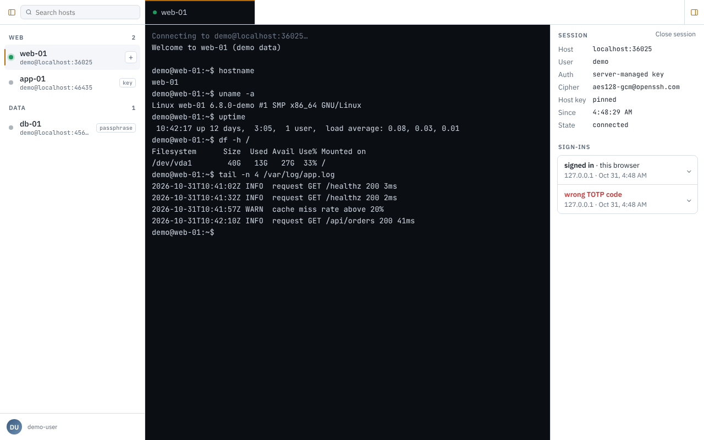

The screenshots show a local instance with demo hosts and a demo account. No real hosts, keys or identities appear in them.

## Features

- **GitHub sign-in plus a one-time code.** Only GitHub accounts listed in `config.json` can get in, and each needs a time-based code from an authenticator app. A code can't be used twice.
- **Preconfigured hosts only.** Administrators define hosts, credentials and pinned host keys on the server. Users pick a host from the list. They can't add connections or see private keys.
- **Passphrases typed in the browser.** If a key is passphrase-protected, the terminal asks for the passphrase when you connect. It is never stored or logged.
- **Tabs and sessions.** Open several sessions to the same host, drag tabs to reorder them, and check your recent sign-ins in the session panel.
- **File explorer per tab.** The folder icon on an SSH tab switches that tab between the terminal and its files, over SFTP on the same connection. Browse, view small text files, download, and delete. It acts as the host's SSH user, so the host's own permissions apply. Upload is not supported yet.
- **Works on a phone.** The host list and session panel open over the terminal on small screens.

## Screens

Shellport follows your system's light or dark setting. Dark is the default, and light applies when your system prefers light. There is no in-app switch.

### Light theme

<table>
  <tr>
    <td width="50%">
      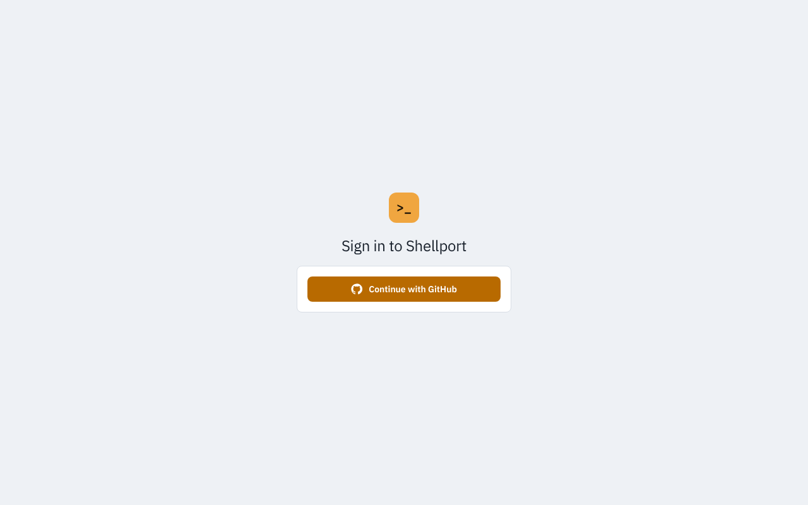<br>
      <sub>Sign in with GitHub</sub>
    </td>
    <td width="50%">
      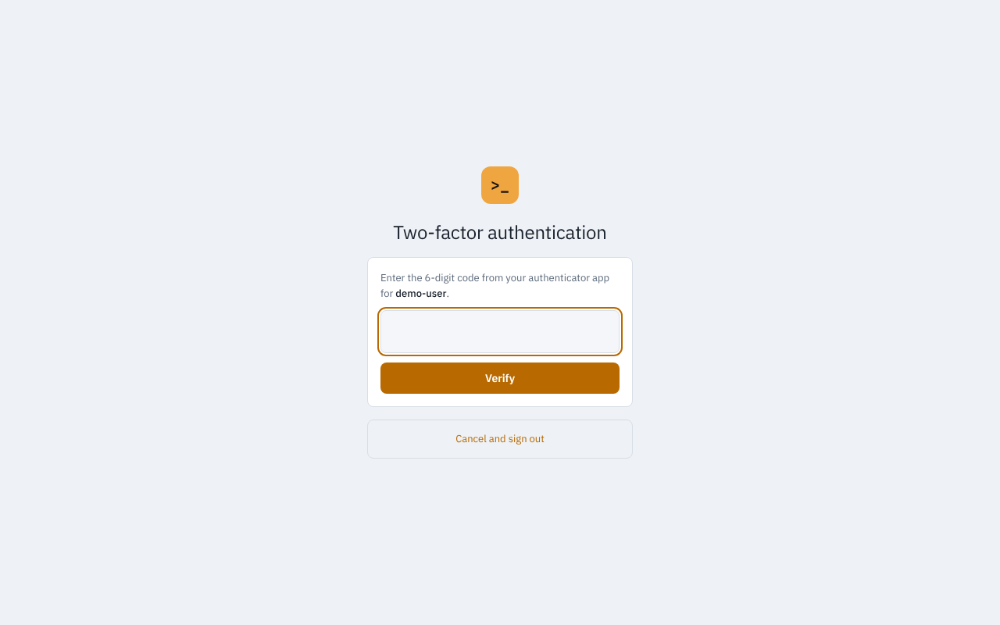<br>
      <sub>Enter the code from your authenticator app</sub>
    </td>
  </tr>
  <tr>
    <td width="50%">
      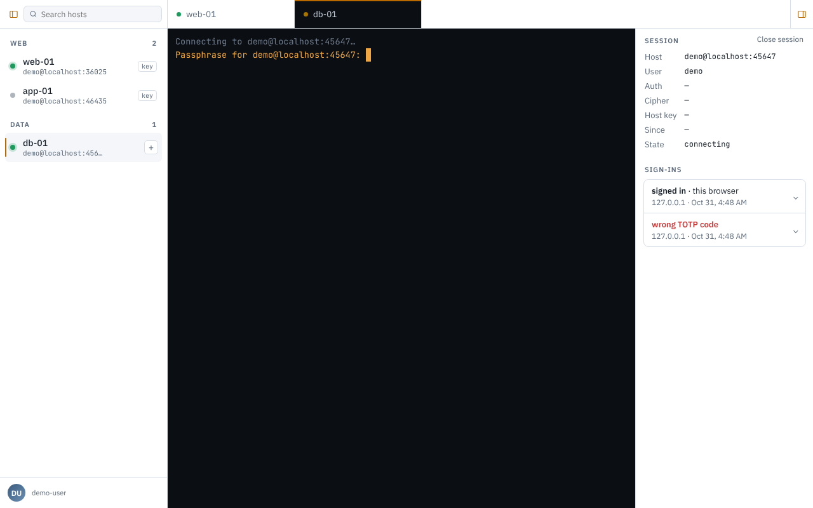<br>
      <sub>Passphrase prompt for a protected key</sub>
    </td>
    <td width="50%">
      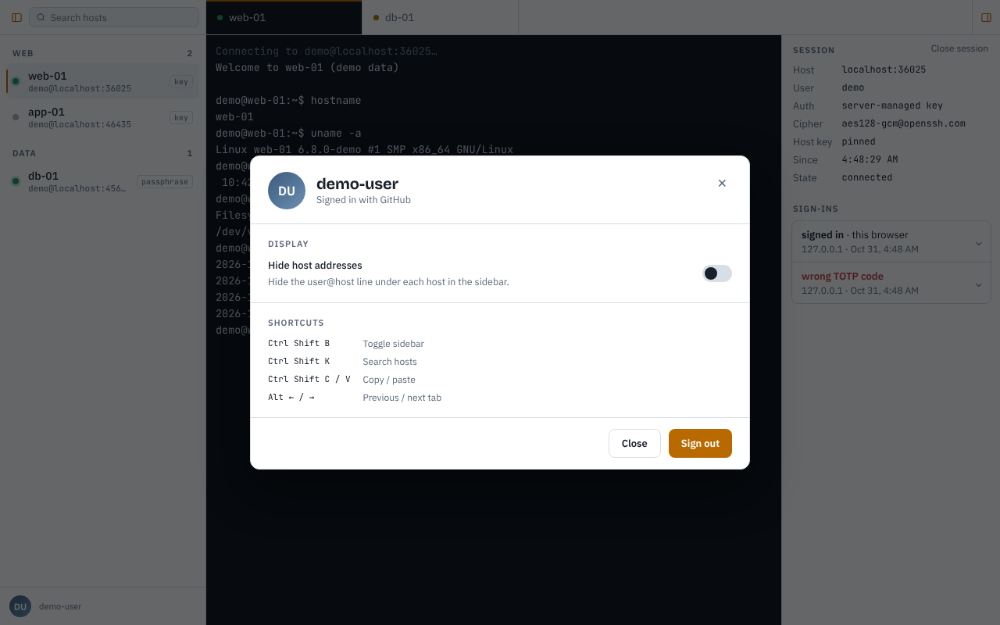<br>
      <sub>Account dialog, with shortcuts and sign out</sub>
    </td>
  </tr>
</table>

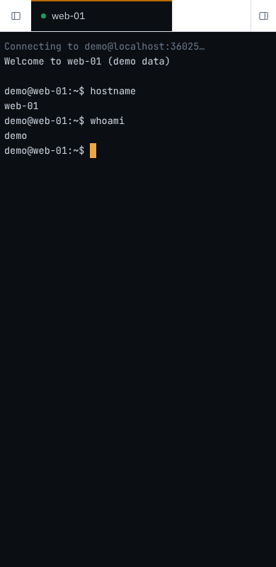<br>
<sub>The terminal on a phone</sub>

### Dark theme

<table>
  <tr>
    <td width="50%">
      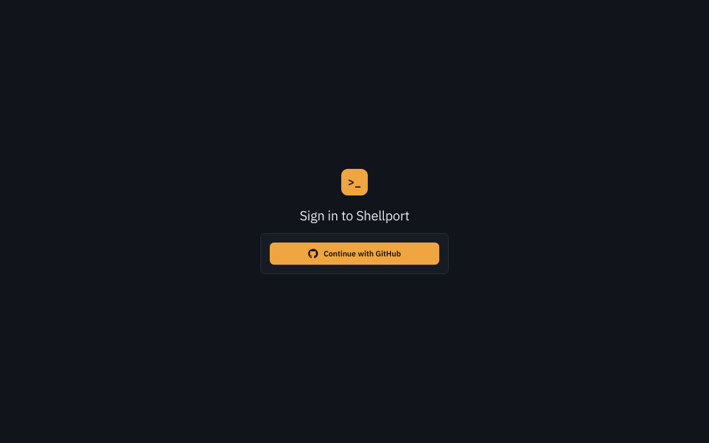<br>
      <sub>Sign in with GitHub</sub>
    </td>
    <td width="50%">
      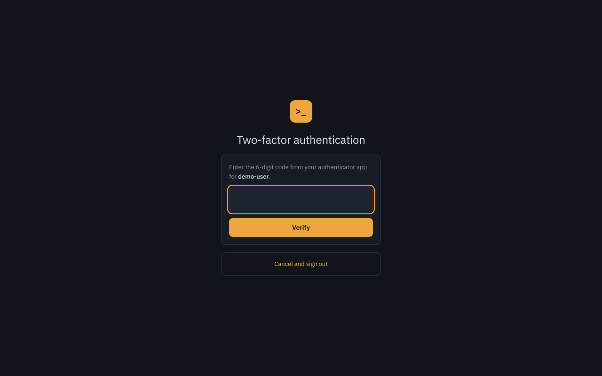<br>
      <sub>Enter the code from your authenticator app</sub>
    </td>
  </tr>
  <tr>
    <td width="50%">
      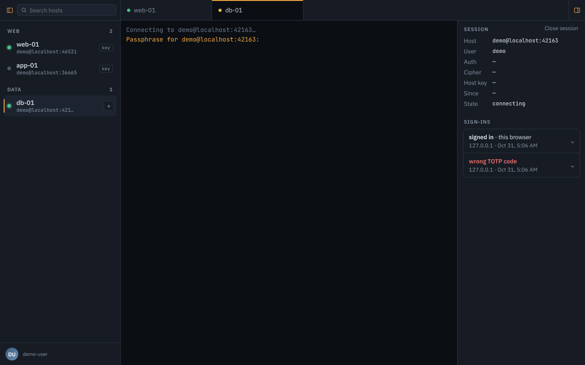<br>
      <sub>Passphrase prompt for a protected key</sub>
    </td>
    <td width="50%">
      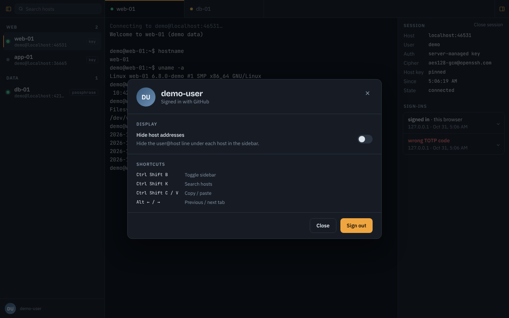<br>
      <sub>Account dialog, with shortcuts and sign out</sub>
    </td>
  </tr>
</table>

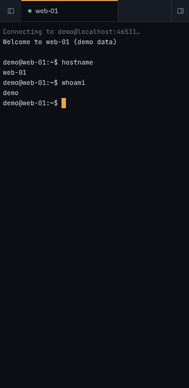<br>
<sub>The terminal on a phone</sub>

## Quick start with Docker

You need Docker and a GitHub OAuth app.

1. **Create a GitHub OAuth app.** In GitHub, go to **Settings → Developer settings → OAuth Apps → New OAuth App**. Set the authorization callback URL to `http://localhost:8080/auth/github/callback`.

2. **Create your local files.**

   ```sh
   cp config.local.example.json config.json
   cp .env.example .env
   mkdir -p keys
   ```

3. **Create an authenticator secret for your GitHub login.**

   ```sh
   docker compose run --rm --no-deps --entrypoint node shellport dist/totp-cli.js <github-login>
   ```

   The command prints a QR code and a secret. Scan the code with your authenticator app. Then put the secret in `.env` as `SHELLPORT_TOTP_USER`, the variable that `config.local.example.json` reads.

4. **Edit `.env` and `config.json`.** In `.env`, set `SHELLPORT_GITHUB_SECRET` to your OAuth client secret. If you keep the example host, also set `SHELLPORT_HOST_PASSWORD`. In `config.json`, set `github.clientId` to your OAuth client ID, and replace the example user with your numeric GitHub ID or login. Then set up your hosts (see [Configuration](#configuration)).

5. **Start Shellport.**

   ```sh
   docker compose up -d --build
   ```

   Open `http://localhost:8080` and sign in.

## Try it with demo hosts

To test without real servers, start two demo SSH servers in Docker: one with a plain key and one with a passphrase-protected key. You still need the OAuth app and authenticator secret from the quick start.

```sh
npm run demo:setup
docker compose -f docker-compose.yml -f docker-compose.demo.yml up -d --build
```

The setup generates the keys, starts the demo servers and pins their host keys in `config.json`. The passphrase for the protected key is saved to `demo-locked.passphrase`.

## Production with HTTPS

The `deploy/` folder runs Shellport behind Caddy, which handles HTTPS certificates.

1. Set `server.publicUrl` in `config.json` to your HTTPS address, for example `https://ssh.example.com`.
2. Set the same callback URL on your OAuth app: `https://ssh.example.com/auth/github/callback`.
3. Copy `config.json`, `.env` and `keys/` into `deploy/`, and set your domain in `deploy/Caddyfile`.
4. From `deploy/`, run `docker compose up -d`.

## Configuration

Shellport reads `config.json`. Start from [`config.example.json`](config.example.json). A secret can be a plain string, `{ "env": "VAR_NAME" }` or `{ "file": "path/to/file" }`. Prefer the `env` or `file` forms so secrets stay out of `config.json`.

| Section | What it controls |
| --- | --- |
| `server` | Port, listen address, `publicUrl` (the origin used for OAuth redirects and WebSocket checks) and `trustProxy`. |
| `github` | OAuth app `clientId` and `clientSecret`. |
| `users` | Who may sign in, by numeric GitHub ID or login, each with a `totpSecret`. |
| `hosts` | Preconfigured SSH destinations: address, user, credentials, pinned `hostKeyFingerprints`, optional `allowedUsers`, and `files` (set it to `false` to turn off the file explorer for that host; it is on by default). |
| `limits` | Terminals per user, idle timeout, sign-in attempts per 15 minutes, and `maxDownloadMB` (largest file the explorer will download, default 256). |
| `session` | How long a sign-in lasts (`ttlHours`). |
| `security` | Security options. Leave `allowUnpinnedHostKeys` at `false`. |

To pin a host key, run `ssh-keyscan <host> | ssh-keygen -lf -` and copy the `SHA256:` fingerprint into `hostKeyFingerprints`. Shellport refuses to connect if the fingerprint changes.

**Host authentication**

- **SSH key:** the private key stays on the server. If the key is passphrase-protected, the user types the passphrase in the terminal tab when connecting.
- **Password:** stored on the server as an `env` or `file` secret. It is never sent to the browser.

**Setup wizard.** If Shellport starts without a `config.json`, it opens a setup wizard instead of the app. The wizard can configure the server, GitHub OAuth, session limits and SSH hosts. It can also generate TOTP secrets with QR codes, check the config against the schema, and download `config.json`. You can force the wizard with `SHELLPORT_SETUP=1`.

## Sealed mode

Sealed mode keeps your configuration and SSH keys encrypted on disk. Instead of `config.json` and `.env`, Shellport has one file, `vault.sealed`, and it starts "sealed": the only page it serves is an unseal screen. Someone who knows the passphrase unlocks it in the browser, after which the usual GitHub sign-in and TOTP code apply. Nothing is ever written to disk in plain text.

**Migrating an existing install.** If Shellport starts and finds a plain `config.json` with no vault, it does not start the app. It opens a migration page instead and prints a one-time **migration code** in its log (`docker compose logs shellport`). Enter the code and a new passphrase, and Shellport encrypts the config (inlining `.env` values and key files), writes `vault.sealed`, and starts the app already unsealed. Or choose **Continue without encrypting** to start as before; you will be asked again on the next start unless you set `SHELLPORT_MIGRATE=off`. The page accepts the passphrase over HTTPS or on localhost only. The Docker compose files mount a `./vault` folder for this (create it first with `mkdir vault`; on Linux it must be writable by user 1000). Afterwards remove `config.json`, `.env` and `keys/` and their lines from the compose file, because Shellport refuses to start while a vault and a `config.json` both exist.

**Create a vault.** Either tick **Encrypt the configuration with a passphrase** on the setup wizard's last step, or convert an existing setup:

```sh
npm run vault -- seal      # reads config.json, inlines .env and key-file values, writes vault.sealed
```

Then delete `config.json`, `.env` and the key files. Shellport refuses to start while a vault and a `config.json` both exist. In Docker, run the command with `docker compose run --rm --no-deps --entrypoint node shellport dist/vault-cli.js seal`.

**Day to day.**

- After every restart the server is sealed until someone enters the passphrase. Passphrases need at least 12 characters.
- **Seal server** in the account menu locks it again: everyone is signed out and every terminal closes.
- Five wrong passphrases lock unsealing for everyone for a minute, then 2, 5 and 15 minutes on repeats. Unsealing is accepted over HTTPS or from the local machine only.
- With a vault, secrets must be written into it directly. `{"env": ...}` and `{"file": ...}` references are refused, and `npm run vault -- seal` and `import` resolve them for you.
- While sealed, only these environment variables apply: `PORT`, `HOST`, `SHELLPORT_TRUST_PROXY` (set it behind a reverse proxy so the HTTPS check works), `SHELLPORT_VAULT` (default `vault.sealed`) and `SHELLPORT_CONFIG`. The sealed `/healthz` still answers 200 and reports `"sealed": true`.

**Command line.** Run `npm run vault -- <command>` (or `node dist/vault-cli.js <command>`):

| Command | What it does |
| --- | --- |
| `seal` | Encrypt `config.json` into `vault.sealed`. |
| `unseal` | Unlock a running sealed server on the same machine through a local socket. It is not subject to the web lockout, so you can still recover if someone locked it. |
| `edit` | Decrypt to a private temporary file, open `$EDITOR`, check the result, and re-encrypt. |
| `check` | Verify the passphrase and that the config is valid. |
| `passphrase` | Change the passphrase without re-encrypting the contents. |
| `export <file>` | Write the decrypted config as plain JSON (mode 0600). Handle it like the secrets it contains. |
| `import <file>` | Replace the vault contents from a plain JSON config. |

A running server keeps the config it unsealed with. After `edit` or `import`, seal and unseal it again, or restart it. To back up, copy `vault.sealed`; it is safe to store anywhere the passphrase is not.

**There is no recovery.** If the passphrase is lost, the vault cannot be opened. Keep the passphrase in a password manager and a second copy of `vault.sealed` somewhere separate. A damaged or unsupported vault stops the server with a clear message instead of falling back to the setup wizard.

## Using Shellport

- **Tab bar.** The sidebar toggle and the host search box sit at the left. Each session is a tab. Drag tabs to reorder them.
- **Host list.** Click a host to open a terminal. Hover over a host, or focus it with the keyboard, and click **+** to open another session to the same host.
- **Session panel.** The panel on the right of the tab bar shows the connection details and your recent sign-ins. **Sign out others** and **Close session** are buttons at the bottom: the first ends your other sessions, the second closes the active tab. Use the toggle in the tab bar to hide the panel.
- **Files.** Click the folder icon on a tab to see the host's files, and click it again to go back to the terminal. Click a file or folder to select it, double-click to open a folder or view a file, and right-click for **View** or **Open**, **Download** and **Delete**. The path bar has **Up** and **Refresh**. Delete asks first, removes one file or one empty folder, and can't be undone. The viewer is read only and shows the first 256 KB of a text file.
- **Account.** Click your avatar for the account dialog. It shows your login, a **Hide host addresses** switch (stored in this browser only), the keyboard shortcuts, and **Sign out**. Signing out asks first, because it disconnects your open terminals.

| Shortcut | Action |
| --- | --- |
| `Ctrl` `Shift` `B` | Toggle the sidebar |
| `Ctrl` `Shift` `K` | Search hosts |
| `Ctrl` `Shift` `C` / `V` | Copy / paste |
| `Alt` `←` / `→` | Previous / next tab |

## Development

You need Node.js 24 or newer.

```sh
npm ci
npm run build
cp config.local.example.json config.json
cp .env.example .env
npm run totp -- <github-login>   # put the secret in .env as SHELLPORT_TOTP_USER
node --env-file=.env dist/server.js
```

Shellport refuses to start until `.env` has `SHELLPORT_GITHUB_SECRET` and `SHELLPORT_TOTP_USER`, and `SHELLPORT_HOST_PASSWORD` if the example host is still in `config.json`. Then open `http://localhost:8080`. Shellport reads `config.json` from the current folder, or from the path in `SHELLPORT_CONFIG`.

## Testing

```sh
npm test                 # unit and end-to-end tests
npm run typecheck        # TypeScript checks
npm run smoke -- <url>   # black-box security and header checks against a running instance
npm run smoke:full       # real SSH containers and a headless browser (needs Docker)
```

Set `SMOKE_SCREENSHOTS=<folder>` with `npm run smoke:full` to save UI screenshots.

## Security

Shellport gives a signed-in user a shell on the hosts they are allowed to reach, so the server and its configuration need to be protected. Read [SECURITY.md](SECURITY.md) for the threat model and for how to report a vulnerability.

## License

[AGPL-3.0](LICENSE)
